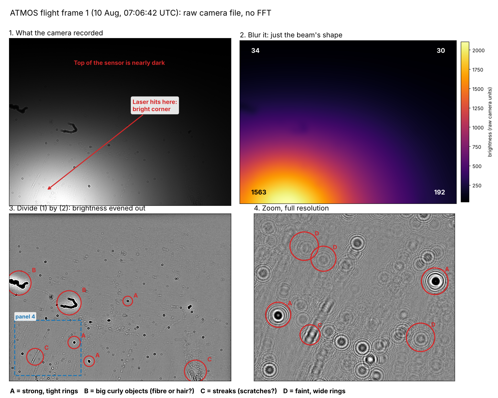

# ATMOS Flight Analysis

Analysing the holographic camera data from the ATMOS climate payload's August 2026 flight, starting from the raw camera files.



## Background

ATMOS is Durham University Spaceflight's climate science payload. I was team lead for the payload.

It images airborne particles using **digital in-line holography**. A 520 nm laser shines across an open sample gap onto a bare camera sensor, with no lens. Anything in the beam scatters light, which interferes with the main beam and leaves a ring-shaped pattern (a hologram) on the sensor. The rings encode the object's size and its distance from the sensor.

The payload flew at the Launch 4 Change (L4C) event in August 2026 and recorded particle images. 

| Part | What it does |
|---|---|
| Raspberry Pi 5 | Runs the camera and laser, stores frames |
| Daheng MER2-1220 mono camera | 4024 × 3036 pixels, 1.85 µm pixel size |
| TOPTICA iBeam smart laser | 520 nm illumination |
| Custom sensor board (Arduino Nano ESP32) | Temperature, pressure, ozone, CO₂ and airflow |


## Status

| Step | Status |
|---|---|
| Decode the raw camera files | Done |
| Map the laser beam and even out brightness | Done |
| Detect and count ring patterns in each frame | Next |
| Track particles across frames: stuck or floating? | Planned |
| Estimate particle sizes | Planned |
| Add the sensor board firmware | Planned |

## First results (flight frame 1)

- **The laser beam is off-centre.** After smoothing, the bottom-left corner of the sensor reads about 1,560 while the top corners read about 30, so the top of the sensor gets roughly 1/50 of the light. Particles there are much harder to see. That's a fix for the next flight.
- **Hundreds of ring patterns appear across the whole sensor** once the beam shape is divided out, including many that don't show in the background-subtracted images.
- **There are at least four kinds of feature:** strong, tight rings; faint, wide rings; large curly objects (possibly fibres); and streaks (possibly scratches). Since ring size depends on distance from the sensor, the tight and wide rings are likely at different depths.

## The raw file format

The camera files have no header and no documentation, so the format was worked out from the file size:

- 24,433,728 bytes = 4024 × 3036 pixels × 2 bytes, so 2 bytes per pixel
- Values range from 18 to 2,805, under 4,096, so they're 12-bit readings stored in 16-bit slots
- Reading the bytes in big-endian order gives nonsense (values up to 65,000), so they're little-endian

```python
import numpy as np
img = np.fromfile("frame.raw", dtype="<u2").reshape(3036, 4024)
```

## Data

Raw frames are 23 MB each, so the full flight isn't stored in this repo.

- `samples/` holds flight frame 1, so the code runs straight after cloning.
- Put the full set of frames in `data/`. It's ignored by git.
- The processed image package (background-subtracted and reconstructed frames) and frame-by-frame metadata are in the society's [ATMOS_2026_L4CData](https://github.com/DU-Spaceflight/ATMOS_2026_L4CData) repo.

## Credits

- **Flight data:** DU Spaceflight ATMOS team.
- **Processed image package** (background subtraction, Fresnel reconstruction, autofocus) and the laser control script: Walker, in [ATMOS_2026_L4CData](https://github.com/DU-Spaceflight/ATMOS_2026_L4CData). Not part of this repo.
- **Analysis code in this repo:** Rohan Memon, developed with AI assistance (Claude).