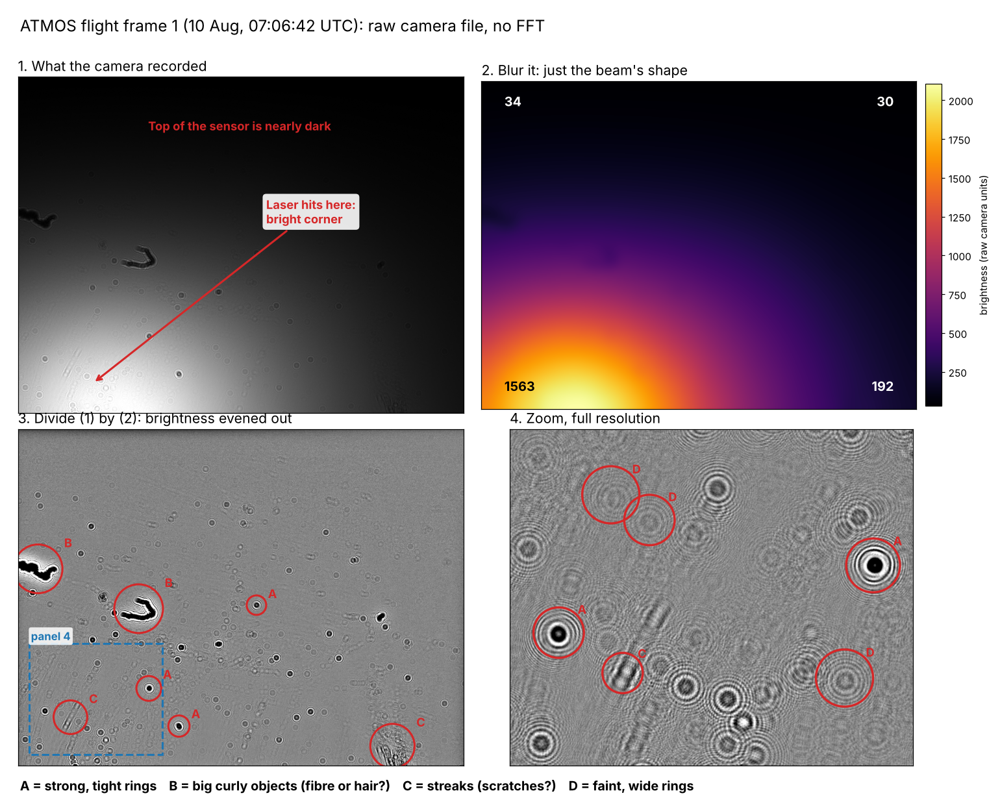
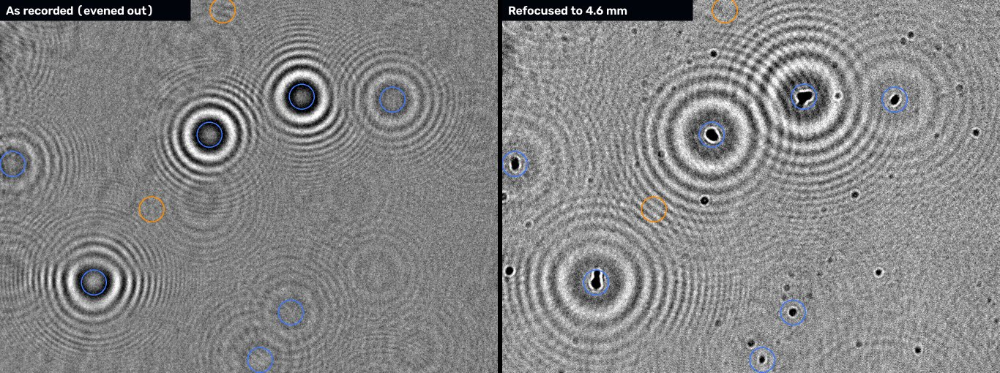

# ATMOS Flight Analysis

Analysing the holographic camera data from the ATMOS climate payload's August 2026 flight, starting from the raw camera files.



## Background

ATMOS is Durham University Spaceflight's climate science payload. I was team lead for the payload.

It images airborne particles using **digital in-line holography**. A 520 nm laser shines across an open sample gap onto a bare camera sensor, with no lens. Anything in the beam scatters light, which interferes with the main beam and leaves a ring-shaped pattern (a hologram) on the sensor. The rings encode the object's size and its distance from the sensor.

The payload flew at the Launch 4 Change (L4C) event in August 2026 and recorded particle images. 

| Part | What it does |
|---|---|
| Raspberry Pi 5 | Runs the camera and laser, stores frames |
| Daheng MER2-1220 mono camera | 4024 × 3036 pixels, 1.85 µm pixel size |
| TOPTICA iBeam smart laser | 520 nm illumination |
| Custom sensor board (Arduino Nano ESP32) | Temperature, pressure, ozone, CO₂ and airflow |


## Status

| Step | Status |
|---|---|
| Decode the raw camera files | Done |
| Map the laser beam and even out brightness | Done |
| Find particles by refocusing the hologram | Done |
| Estimate particle sizes and distances from their rings | Done |
| Track particles across frames: stuck or floating? | Planned |
| Add the sensor board firmware | Planned |

## How the code finds particles

`src/run.py` runs every step on a folder of frames. For each frame:

1. **Even out the beam** (`flatten.py`). Divide by a smooth map of the laser beam, so every pixel reads as a fraction of normal brightness (1.0 = nothing there).
2. **Refocus** (`detect.py`, using `optics.Refocuser`). Run the light backwards to depths from 2.5 to 26 mm. Each particle's rings gather back into one small dark dot at its own depth, so even rings fainter than the noise add up into a dot you can see.
3. **Find the dots.** Mark every spot at least 8 times darker than the noise around it, and keep each particle once, at the depth where it's sharpest.
4. **Is it a particle?** (`describe.py`). In focus, a particle is a compact dot. Fibres and streaks are lines, and big fibres black out the area around them, so both are left out.
5. **Size it** (`size.py`). Fit the exact diffraction pattern of a round particle to its rings, which gives both its diameter and its distance from the sensor.

The first version found particles by squaring the rings and blurring them into one "hill" per particle. Squaring throws away whether each ring is dark or bright, so faint rings drowned in the noise. Next to bright particles, they made no hill of their own. In a busy patch of frame 1 it found 7 particles; refocusing finds 21, and about 25 can be counted by eye. Across the whole frame it's 583 particles, up from 216:



## First results (flight frame 1)

- **The laser beam is off-centre.** After smoothing, the bottom-left corner of the sensor reads about 1,560 while the top corners read about 30, so the top of the sensor gets roughly 1/50 of the light. Particles there are much harder to see. That's a fix for the next flight.
- **Hundreds of ring patterns appear across the whole sensor** once the beam shape is divided out, including many that don't show in the background-subtracted images.
- **There are at least four kinds of feature:** strong, tight rings; faint, wide rings; large curly objects (possibly fibres); and streaks (possibly scratches). Since ring size depends on distance from the sensor, the tight and wide rings are likely at different depths.

## The raw file format

The camera files have no header and no documentation, so the format was worked out from the file size:

- 24,433,728 bytes = 4024 × 3036 pixels × 2 bytes, so 2 bytes per pixel
- Values range from 18 to 2,805, under 4,096, so they're 12-bit readings stored in 16-bit slots
- Reading the bytes in big-endian order gives nonsense (values up to 65,000), so they're little-endian

```python
import numpy as np
img = np.fromfile("frame.raw", dtype="<u2").reshape(3036, 4024)
```

## Data

Raw frames are 23 MB each, so the full flight isn't stored in this repo.

- `samples/` holds flight frame 1, so the code runs straight after cloning.
- Put the full set of frames in `data/`. It's ignored by git.
- The processed image package (background-subtracted and reconstructed frames) and frame-by-frame metadata are in the society's [ATMOS_2026_L4CData](https://github.com/DU-Spaceflight/ATMOS_2026_L4CData) repo.

## Credits

- **Flight data:** DU Spaceflight ATMOS team.
